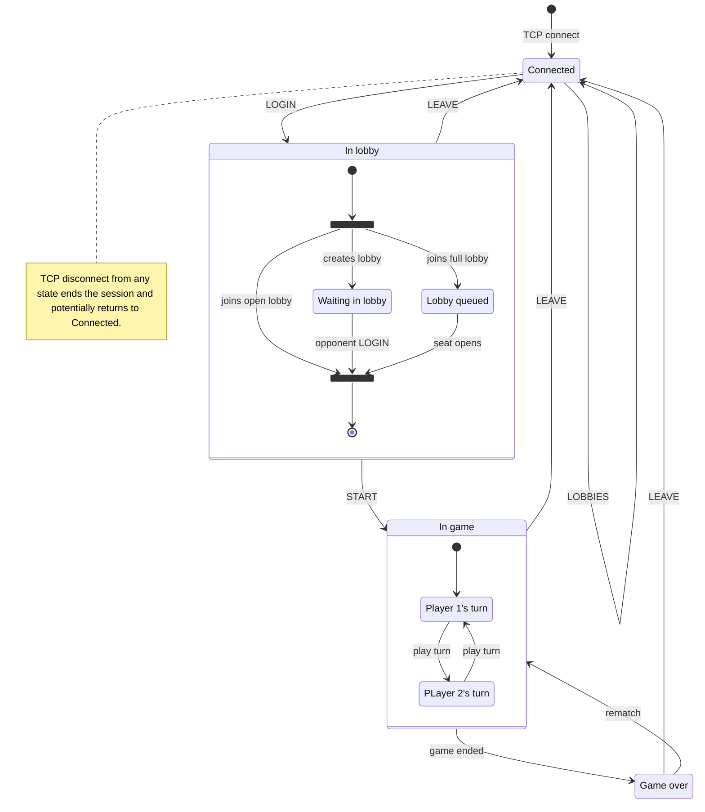

# Hive Protocol

```lpeg
digit     ::= [0-9]
alpha_num ::= [A-Za-z0-9_-]
sep       ::= " "

magic     ::= "HIVE" sep

nick_len  ::= digit digit -- 01-16
lobby_len ::= digit digit -- 01-32
count     ::= digit digit -- 00-99
nick      ::= SEQUENCE { nick_len, alpha_num* }
lobby     ::= SEQUENCE { lobby_len, alpha_num* }

coord     ::= SEQUENCE { ["-"], digit+ }   -- int32 range, variable width
-- tile position (p, q)
pos ::= SEQUENCE {
    coord,
    sep,
    coord
}
-- lobby entry: name + occupant count
lobby_entry ::= SEQUENCE {
    lobby,
    sep,
    count
}
piece ::= "Q" -- queen
        / "S" -- spider
        / "B" -- beetle
        / "G" -- grasshopper
        / "A" -- ant
color ::= "W" / "B" -- white / black
rej_code ::= "BAD_SYNTAX"    -- malformed message (bad name lens,
           / "BAD_NAME"      -- bad nick/lobby charset or len,
           / "NOT_YOUR_TURN" -- not your turn,
           / "ILLEGAL_MOVE"  -- illegal place/move per rules,
           / "BAD_STATE"     -- message illegal in this state
end_reason ::= "SURROUND" -- queen surrounded
             / "FORFEIT"  -- opponent left / disconnected
lobby_state ::= "WAITING"       -- host waiting for guest
              / "QUEUED"        -- queued, `count` = 1-based pos
              / "PROMOTED"      -- promoted queue -> active seat
              / "REMATCH_WAIT"  -- REMATCH vote recorded, wait opp.

-- create/join lobby
login ::= SEQUENCE {
    "LOGIN",
    sep,
    nick,
    sep,
    lobby
}
-- place at (p,q)
place ::= SEQUENCE {
    "PLACE",
    sep,
    pos,
    sep,
    piece
}
-- move (fp,fq)->(tp,tq); piece disambiguates stacks
move ::= SEQUENCE {
    "MOVE",
    sep,
    pos,
    sep,
    pos,
    sep,
    piece
}
rematch ::= "REMATCH"  -- vote play-again
leave ::= "LEAVE"      -- leave lobby / cancel wait
list_req ::= "LIST"    -- lobby-listing request

ack ::= "ACK" -- generic accept
-- reject, sender only
reject ::= SEQUENCE {
    "REJECT",
    sep,
    rej_code
}
-- game start: your color + opp nick
start ::= SEQUENCE {
    "START",
    sep,
    color,
    sep,
    nick
}
-- game end, expect REMATCH/LEAVE
over ::= SEQUENCE {
    "OVER",
    sep,
    color,
    sep,
    end_reason
}
-- status (`count` only with QUEUED)
lobby_status ::= SEQUENCE {
    "LOBBY",
    sep,
    lobby_state,
    [sep, count]
}
-- entries: lobby-name + nplayers each;
-- outer count = number of entries;
list_resp ::= SEQUENCE {
    "LOBBIES",
    sep,
    count,
    ( sep, lobby_entry ) *
}

command ::= alternative {
  login, place, move, rematch, leave, list_req,
  ack, reject, start, over, lobby_status, list_resp,
  place
}

message ::= SEQUENCE { magic, command, "\n" }
```

## Session state machine


